<div align="center">

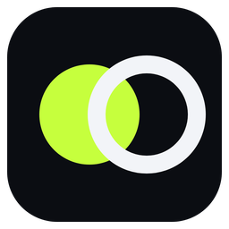

# Flag Clash

**Viral flag-battle videos for YouTube, made and posted for you.**

Flag Clash renders physics game videos on your Windows PC and posts them to your YouTube channel on a natural,
human-looking schedule, while it sits quietly in the system tray.

[](https://github.com/MisbahKhan0009/battle-world/actions/workflows/desktop.yml)


[**Download**](#-download-and-install) &nbsp;&nbsp; [**Set up your channel**](#-set-up-your-channel-5-minutes) &nbsp;&nbsp; [**Daily use**](#%EF%B8%8F-using-flag-clash) &nbsp;&nbsp; [**How it posts**](#-how-the-autopilot-posts) &nbsp;&nbsp; [**Help**](#%EF%B8%8F-troubleshooting)

<br />

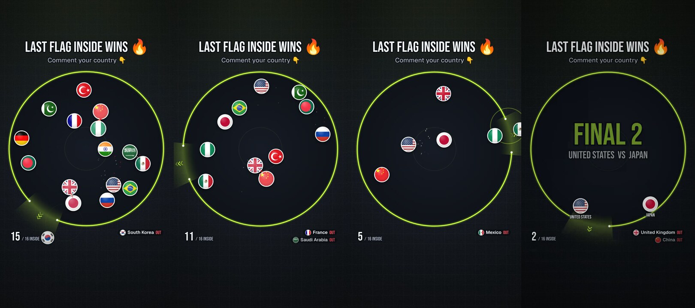

</div>

<br />

## ✨ What it does

| | |
| --- | --- |
| 🎬 **Makes the videos** | Six games so far. **Flag Battle**: up to 64 country flags bounce inside a circle with one rotating exit; the last flag inside wins. **Marble Race**: flag marbles roll down a track of ramps, plinko pegs, spinners and bumpers; first across the line wins. **Ring Escape**: flag balls bounce inside spinning rings and shatter each one they slip through; first out of the last ring wins. **Growing Ball**: every bounce off the wall makes a flag bigger; when the arena is full, the biggest wins. **Paper Land**: like Paper.io, flags draw trails to claim land and cut each other's trails; when the clock runs out, the most land wins. **Black Hole**: like Hole.io, country holes swallow a city and then each other; when the clock runs out, the biggest hole wins. No two posts repeat a winner, a lineup or even a flag count. |
| 🙂 **Countryballs** | Every flag is a countryball with cartoon eyes that look where it's going and react: they blink, squint when hit, look scared in danger, determined when it counts, and smile when they win. Balls squash when they bounce. |
| 📺 **One channel, every game** | Your channel posts every game: one Short a day from each game, plus one long video a day that takes turns between them. You can still connect more channels and split the games between them. |
| 🖼️ **Spoiler-free thumbnails** | Every post gets its own cover ("WHO ESCAPES LAST?") made from the start of the battle, so the thumbnail never gives the winner away. |
| 📅 **Posts on autopilot** | Every day's posts are planned ahead on one timeline so they never overlap, timed for when your audience is most active. Everything is adjustable. |
| 🌙 **Prepare ahead, hands off** | Render and upload a day or up to 30 days at once (then sleep or shut down the PC), prepare the next day or week automatically at a set time, or switch on hands-off mode to always stay days ahead. Videos are scheduled on YouTube for their own time, so they go out even when the PC is off. |
| 🎞️ **Every video under your control** | The Videos page lists every video by day: watch it, edit its title, description or time, make a new one, publish it now, skip it, or approve it first with review before upload. |
| 📊 **Channel dashboard** | Subscribers and views over time, every upload against your typical result, which game performs best, your best hours to post, and your top videos, in one page. |
| 🗓️ **Calendar and live tracking** | One calendar for every game and channel, color-coded with filters per game and per channel. Click any post to watch it render, upload and go live, step by step. |
| 🔊 **Sound that fits** | Every game has its own sound and color world: Flag Battle's punchy hits and brass fanfare in lime, Marble Race's wooden clicks, start-light beeps and bell in cyan or race amber, Ring Escape's glass celesta and shatter in magenta, Growing Ball's water-drop bloops in coral, Paper Land's marimba and scissor snips in mint, Black Hole's gulps and deep whomps in violet. All timed to the action. Prefer music? Point Settings at a folder of YouTube Audio Library tracks and videos use those instead. |
| 🖥️ **Runs in the background** | Lives in the system tray, starts with Windows, renders each post ahead and lets YouTube publish it on the minute. |
| 🔒 **Your account stays yours** | Uses your own free Google Cloud project. Your sign-in is stored in Windows Credential Manager, never in plain files. |
| 💬 **Built for views** | Not marked made for kids, so comments, likes and notifications stay on. Each video asks viewers to call the winner in the comments a second after it starts, ends with a like-and-subscribe card, and gets a curiosity title. |
| 🌍 **Fair line-ups** | Countries that make videos political (North Korea, Israel, Palestine, Taiwan, Kosovo, Western Sahara, Russia, Iran, Afghanistan, Syria) are left out by default. Edit the list in Settings. |
| 📣 **Facebook and Instagram, if you want** | Optional: connect a Facebook Page and its Instagram account on the Platforms page (with a step-by-step guide). They get their own daily plan and post the YouTube videos, so nothing renders twice. YouTube works the same with or without them. |
| 🧩 **Six games and counting** | Flag Battle, Marble Race, Ring Escape, Growing Ball, Paper Land and Black Hole are live. New games plug into the same registry. |

<br />

## 📑 Contents

- [Download and install](#-download-and-install)
- [Set up your channel (5 minutes)](#-set-up-your-channel-5-minutes)
- [Using Flag Clash](#%EF%B8%8F-using-flag-clash)
- [How the autopilot posts](#-how-the-autopilot-posts)
- [Troubleshooting](#%EF%B8%8F-troubleshooting)
- [For developers](#-for-developers)
- [Credits](#-credits)

<br />

## 📥 Download and install

1. Open the [**Releases**](https://github.com/MisbahKhan0009/battle-world/releases) page. Every update to the app
   publishes a new release named **Flag Clash 1.0.N** (the newest is at the top, marked *Latest*).
2. Under **Assets**, download **`Flag.Clash_1.0.N_x64-setup.exe`**.
3. Run it. Windows SmartScreen may show **"Windows protected your PC"** because the app is not code-signed yet:
   click **More info**, then **Run anyway**.
4. Flag Clash opens on its setup guide. Continue below.

> [!TIP]
> **Updating** is the same: download the newest installer and run it. It updates in place and keeps your channels,
> schedule, history and keys. If you ever reinstall from scratch, setup step 5 takes the same `client_secret_….json`
> file again, so there is nothing to retype.

<br />

## 🔑 Set up your channel (5 minutes)

Flag Clash posts through YouTube's official API using a **free Google Cloud project that belongs to you**. The app
includes an interactive guide that walks you through every click, with one-click links, values to copy, and a picture
of each Google page with the right buttons highlighted.

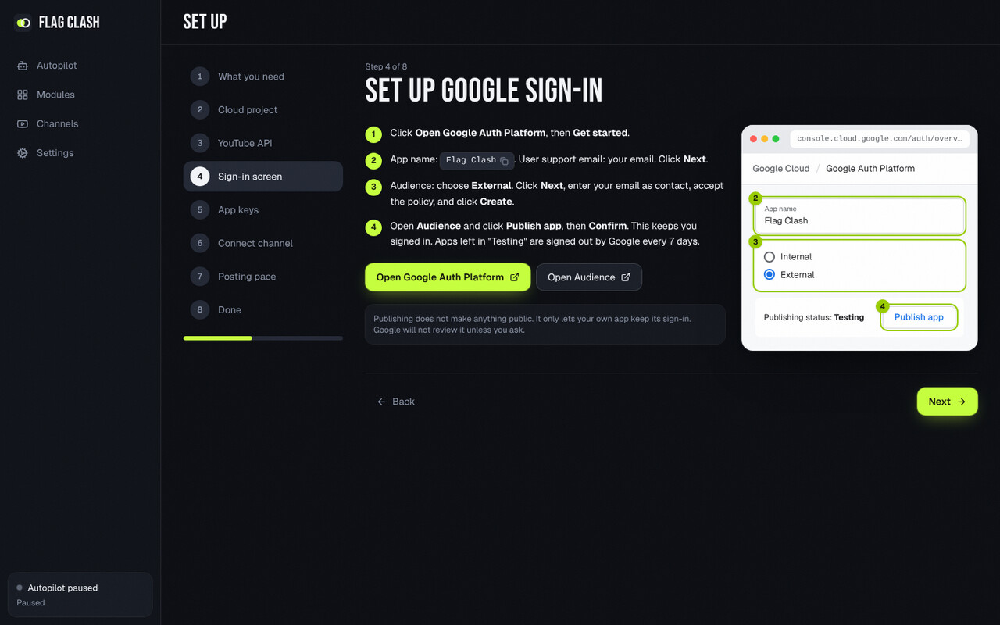

You will need **a Google account that owns a YouTube channel**. No credit card is needed.

<details open>
<summary><b>The steps, in case you want to read them first</b></summary>

<br />

| # | Step | Where | What to do |
| :-: | --- | --- | --- |
| 1 | **Create a project** | [New project](https://console.cloud.google.com/projectcreate) | Name it `Flag Clash` and click **Create**. Make sure it is selected in the project picker at the top. |
| 2 | **Turn on the YouTube API** | [YouTube Data API v3](https://console.cloud.google.com/apis/library/youtube.googleapis.com) | Click **Enable**. |
| 3 | **Set up Google sign-in** | [Google Auth Platform](https://console.cloud.google.com/auth/overview) | Click **Get started**. App name `Flag Clash`, your email as support email, Audience **External**, your email as contact, accept and **Create**. |
| 4 | **Keep the sign-in alive** | [Branding](https://console.cloud.google.com/auth/branding), then [Audience](https://console.cloud.google.com/auth/audience) | On Branding, add an **Application home page** and **Privacy policy link** (two pages on a site you own, for example a free `yourname.github.io` GitHub Pages site) and add that domain under **Authorized domains**. Then on Audience click **Publish app**, **Confirm**. (Apps left in "Testing" are signed out by Google every 7 days.) |
| 5 | **Create the app's keys** | [Clients](https://console.cloud.google.com/auth/clients) | **Create client**, Application type **Desktop app**, name `Flag Clash`, **Create**. Click **Download JSON**, then in Flag Clash click **Choose the downloaded JSON file**. (Pasting the Client ID and secret also works.) |
| 6 | **Connect your channel** | In Flag Clash | Click **Sign in with Google**, pick your channel's account. On "Google hasn't verified this app" click **Advanced**, then **Go to Flag Clash (unsafe)**, and allow both permissions. |
| 7 | **Pick a pace** | In Flag Clash | Maximum (default), Steady or Light, where most of your viewers live, and who can see the videos. Click **Start autopilot**. The week's plan appears right away. |

</details>

<table>
<tr>
<td width="50%">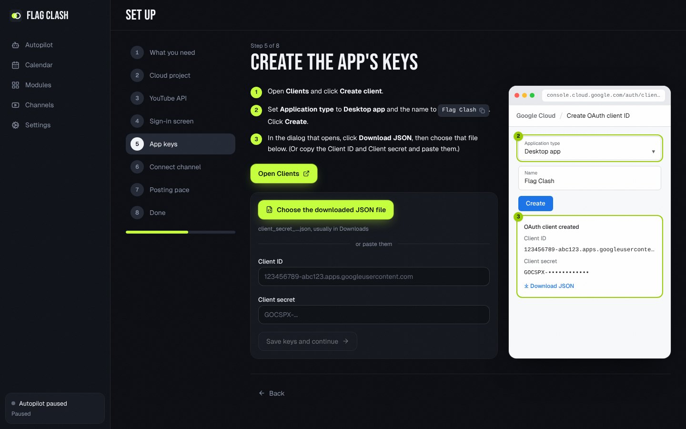</td>
<td width="50%">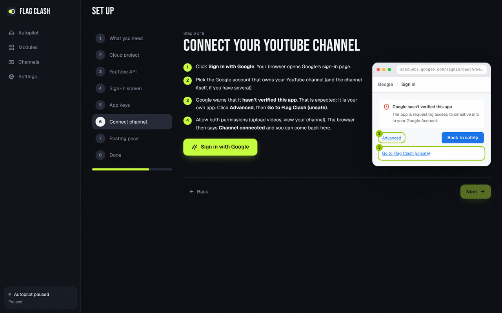</td>
</tr>
<tr>
<td align="center"><sub>Step 5: pick the downloaded JSON, or paste the keys</sub></td>
<td align="center"><sub>Step 6: what to click on Google's warning page</sub></td>
</tr>
</table>

> [!IMPORTANT]
> **Public videos need a one-time audit.** YouTube keeps videos uploaded from a new Google Cloud project **private**
> until the project passes the free [YouTube API audit](https://support.google.com/youtube/contact/yt_api_form).
> Until then, choose **Private for now** in step 7: posts land in YouTube Studio as private videos you can publish
> yourself. After approval, switch visibility to **Public** on the Autopilot page.

> [!NOTE]
> **Is "Go to Flag Clash (unsafe)" safe?** Yes. The warning appears because the sign-in app is *yours* and has not
> been reviewed by Google, not because something is wrong. Flag Clash only asks to upload videos and read your
> channel's name, and the login never leaves your computer.

<br />

## 🎛️ Using Flag Clash

### Dashboard

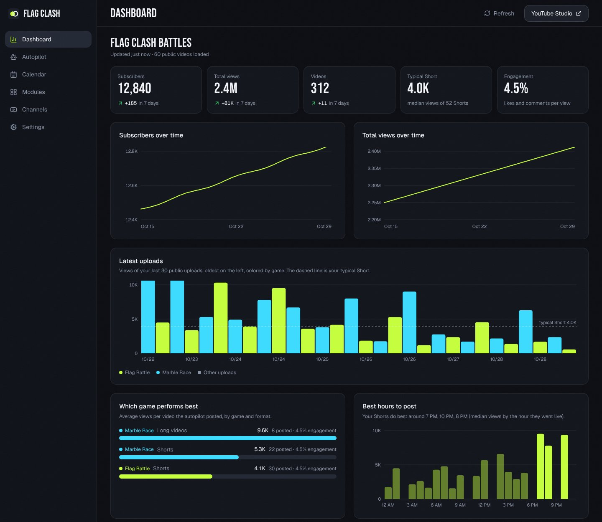

Your channel at a glance, with the things YouTube Studio does not show you:

- **Totals and growth:** subscribers, views and videos with their change over 7 days, and growth charts. Flag
  Clash saves your totals every 3 hours while it runs, so the charts fill in over the first days.
- **Latest uploads:** views of your last 30 uploads, colored by game, against your typical Short (dashed line).
- **Which game performs best:** average views and engagement per game and format, for everything the autopilot
  posted.
- **Best hours to post:** median Short views by the hour they went live, with your top three hours called out.
- **Top videos:** views, views per day, likes, comments and how many times your typical result each one got.

It uses the same read-only YouTube access the app already has (a few API units per refresh), so there is nothing
extra to set up. **Refresh** reloads it; **YouTube Studio** opens your channel there.

### Autopilot

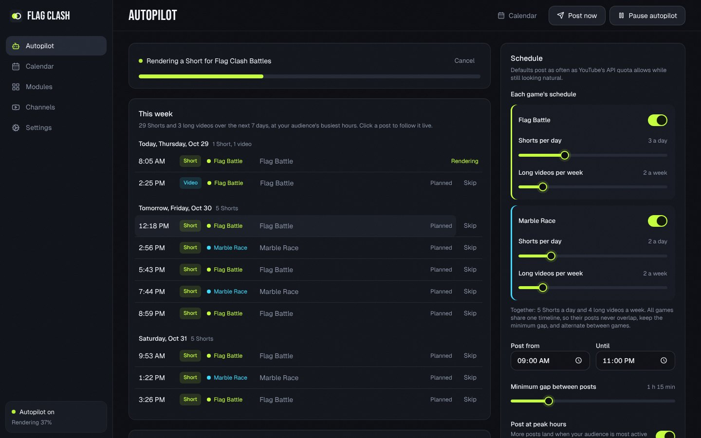

- **The top card** shows what is happening right now (rendering or uploading, with progress) or when the next post
  goes out.
- **This week** lists every post planned for the next 7 days, grouped by day, including ones already uploaded and
  waiting for YouTube to publish them. **Skip** any you don't want.
- **Click any post** to open its timeline: planned, rendering (with a live progress bar), uploading, scheduled on
  YouTube (with a countdown) and live, plus every event, error and retry along the way.
- **Post now** renders and uploads one Short or long video immediately, outside the schedule: pick the channel and
  one of its games. Great for a first test.
- **Pause autopilot** stops new posts (also available from the tray icon).
- **Recent posts** links each upload to YouTube and shows the reason if one failed.
- **Prepare ahead** (right column):
  - **Automatically:** **Every day** at a time you pick (before bed is a good time), the next day's videos are
    rendered and scheduled on YouTube; **Every week** does the next 7 days on the day you pick.
  - **Hands-off mode** always keeps the next days (7 by default, up to 30) rendered and scheduled, so the channel keeps
    posting even if you can't open the app for a while.
  - **Review before upload** holds every rendered video on the Videos page until you approve it.
- **Schedule:** **Long videos a day** (one by default; the games take turns) and, for each game, **Shorts a day**
  (one by default), with how many of each are planned for the next 7 days. Below them are the channel's **daily
  upload limit** and the total for all channels. The posting hours and timing settings underneath apply to every
  channel. Changes stay a draft until you click **Replan the week** (or **Reset** to undo); posts already rendering
  or uploaded are kept.

### Videos

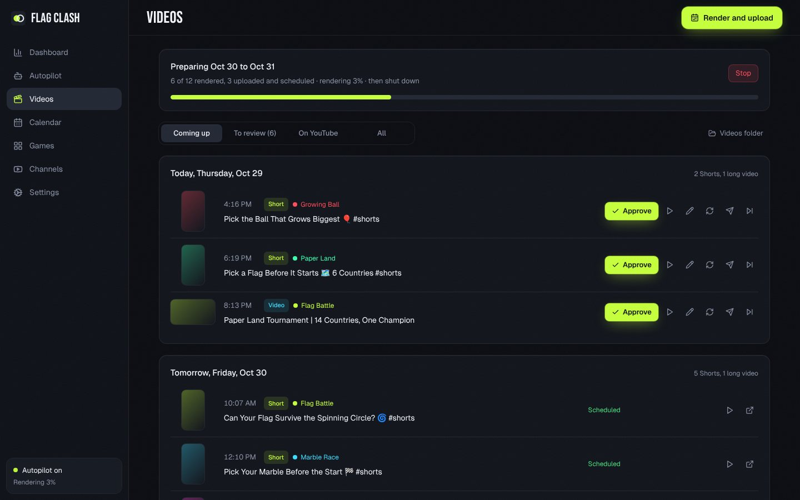

Every video, day by day, with its cover, game, time and status. For each one you can:

- **Play** the rendered file right in the app.
- **Edit** its title, description or the time it goes out (until it is on YouTube).
- **Make a new video** for the same slot (a fresh lineup and game), **Publish now**, **Skip**, or put a skipped one
  back.
- **Approve** it, when **Review before upload** is on (or **Approve all** at once).
- **Pause** it (the pause button) to hold its render or upload, even halfway through, and **Resume** it later.
- **Try again** (the circular arrow) when a render or upload failed or seems stuck. A render or upload with no
  progress for 10 minutes is stopped and tried again on its own.
- **Open on YouTube** (or Facebook) once it is up.

**Render and upload** (top right) prepares a whole day or range now: pick **Tomorrow**, the **next 7, 14 or 30
days**, or any dates. Choose **Render and upload** (scheduled on YouTube for each video's time) or **Render only**
(watch and edit first; each one uploads a few hours before its time), and what the PC does **when it is done**: keep
everything on, **sleep** or **shut down**, after a one-minute countdown you can cancel. YouTube allows 100 uploads a
day per Google project; anything over that goes up after the daily reset. If uploads stay private after their time
(Google projects that have not passed YouTube's API audit lock every upload as private), a banner says so and links
to the audit form.

### Platforms

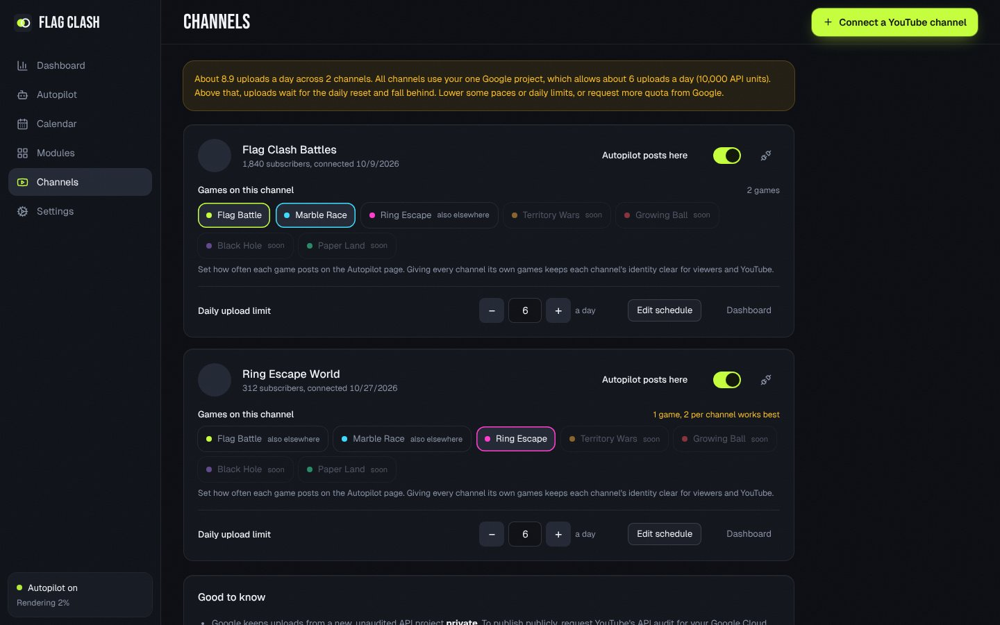

One channel posting every game is the default: the first channel you connect gets every game, and a newly released
game joins it automatically. You can still **connect more channels**; each gets its own card:

- **Games on this channel:** click a game to add or remove it, or **Post every game here**. A later channel gets the
  games no other channel posts yet.
- **Autopilot posts here:** pause or resume one channel without touching the others.
- **Daily upload limit** for that channel (15 by default), and **Edit schedule** for its pace.
- **Disconnect** (the plug icon) stops posting there and removes its access.

All channels share your one Google Cloud project, which can upload **100 videos a day** (its own upload quota; the
other API calls, like custom thumbnails at 50 units each, use the separate 10,000-unit pool). The card at the top
sets **Uploads a day, all channels**.

#### Facebook and Instagram (optional)

Flag Clash can also post to a **Facebook Page** and the **Instagram professional account** linked to it, through
Meta's Graph API. Nothing about YouTube changes if you don't. The **Facebook and Instagram** card on the Platforms
page has the full guide (click **How to connect**); in short:

1. Have a Facebook Page, switch Instagram to a Professional account (Creator or Business) and link it to the Page.
2. Create your own app at [Meta for Developers](https://developers.facebook.com/apps/) (type **Business**). It can
   stay in Development mode for Pages you manage.
3. Add the **Facebook Login for Business** and **Instagram** products.
4. In [Graph API Explorer](https://developers.facebook.com/tools/explorer/), add the permissions `pages_show_list`,
   `pages_read_engagement`, `pages_manage_posts`, `publish_video`, `business_management`, `instagram_basic` and
   `instagram_content_publish`, then **Generate Access Token**.
5. Extend it in the [Access Token Debugger](https://developers.facebook.com/tools/debug/accesstoken/) (**Extend
   Access Token**) and use the long-lived token in Graph API Explorer.
6. Pick your Page under **User or Page** and copy the **Page access token** (made from a long-lived token, it does
   not expire).
7. Paste it into Flag Clash and click **Connect**. The token is kept in Windows Credential Manager.

Each connected account gets its own card and its own plan: one Short (a Reel) a day per game, and on Facebook one
long video a day; Instagram posts Reels only by default. **Post the YouTube videos** (on by default) reuses the
YouTube channel's rendered videos of the same game and length, so nothing renders twice. Facebook long videos are
scheduled on Facebook ahead of time, so they go out with the PC off; Facebook Reels and Instagram posts go out at
their time while Flag Clash runs (preparing ahead still renders them early). Meta allows 50 Instagram posts and 30
Facebook Reels a day through the API, and none of this counts against YouTube's upload quota.

### Calendar

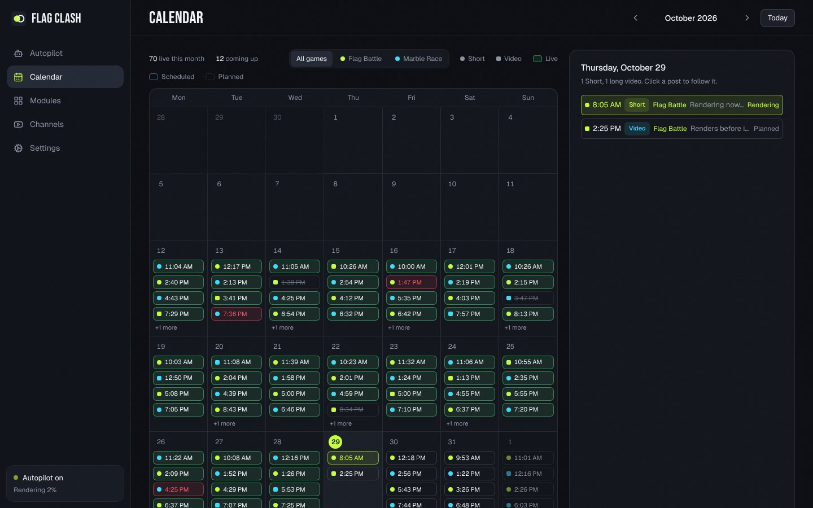

The **Calendar** shows every post of every game and channel by day: **live** ones in green, **scheduled** on YouTube in blue,
**planned** ones (dashed) for the days ahead, plus anything that failed or was skipped. Each post carries its game's
color (a dot for a Short, a square for a long video). With more than one channel, **All channels** picks one
channel, and the game filter shows one game at a time. Click a day to list its posts, and click a post to follow it
live.

### Settings

- **Google API credentials:** load them from the `client_secret_….json` file or paste them.
- **Rendered videos:** the folder videos are saved to (default `Videos\Flag Clash`), and how many days to keep them
  after they go out (default 3; 0 deletes them right after upload).
- **Background:** launch when you sign in to Windows, and keep running in the tray when the window closes (both on
  by default).
- **Music:** turn on **Use music instead of the game sounds** and videos carry one track from your music folder
  (default `Music\Flag Clash Music`) in place of the sound effects. Download tracks from YouTube Studio's
  [Audio Library](https://www.youtube.com/audiolibrary) (MP3, M4A, WAV, OGG or FLAC). Each video picks a track you
  haven't used lately, loops it with a crossfade if the video is longer, and fades it out at the end. If a track
  needs attribution, save the credit line from the Audio Library as a `.txt` file with the same name next to it
  (`Track Name.mp3` + `Track Name.txt`); it is added to the video description. Leave the switch off for the
  synthesized game sounds.
- **Countries:** the countries left out of every game. North Korea, Israel, Palestine, Taiwan, Kosovo, Western
  Sahara, Russia, Iran, Afghanistan and Syria are left out by default; remove one to bring it back, add any other,
  or **Reset** to the default list.
- **About:** the installed version. Newer versions are on the [Releases](https://github.com/MisbahKhan0009/battle-world/releases) page.

### Tray and startup

Closing the window keeps Flag Clash running in the **system tray** (bottom right of the taskbar; click **^** if it
is hidden). Right-click the icon to open the app, start or pause the autopilot, or **Quit**. Flag Clash starts with
Windows by default so the schedule survives restarts; turn that off in **Settings**.

### Marble Race

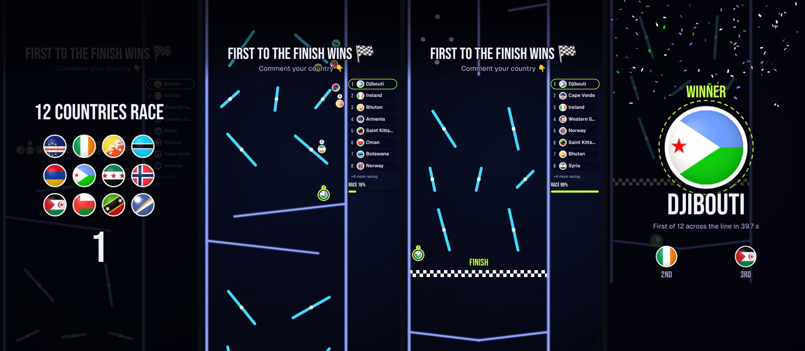

Flag marbles race down a freshly generated track: zigzag **ramps**, **plinko** peg fields, rotating **spinners**,
**bumpers** that kick, funnels, and **forks** where the field splits into two lanes. The camera follows the front of
the race, the standings update live, a **FINAL STRETCH** banner marks the last section, close finishes get a
**PHOTO FINISH** slow motion, and the video ends on the winner alone. Sounds are glassy clicks between marbles and dry wooden clicks on the track (no drum thuds); the start lights beep, a wooden ratchet runs into a photo finish, and the winner gets a tubular bell. Open **Games, Marble Race, Watch a sample
race** to play random races with sound and export one by hand.

### Ring Escape

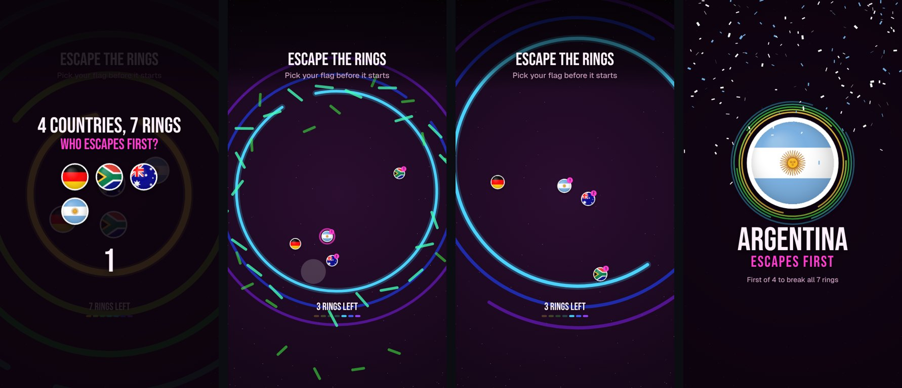

Flag balls drop into the middle of a stack of rainbow rings. Every ring turns at its own speed with one gap in it;
the first ball through a gap **shatters** that ring for everyone, and the first flag out of the **last ring** wins.
The camera follows the balls and widens as the rings get bigger, each flag shows how many rings it broke, and the
last escape plays in slow motion. Shorts are one game of 4 to 8 flags; **long videos are a knockout**: 12 to 20
flags play 3 or 4 heats, and the heat winners meet in the final. Bounces play glassy celesta notes that climb a
pentatonic scale, rings break with a glass shatter, and an airy riser leads into the last escape (no booms or drums). Open **Games, Ring Escape, Watch a
sample game** to play random games with sound and export one by hand.

### Growing Ball

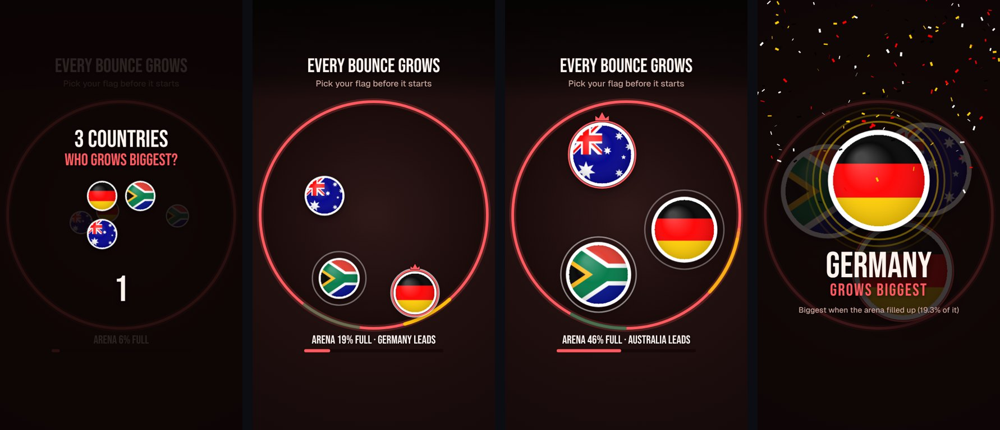

Flag balls bounce around a round arena, and every firm bounce off the wall makes a ball a little bigger. Balls
shove each other around, big ones get boxed in, and small ones keep finding the wall, so the lead changes hands.
The meter shows how full the arena is; when it is full, the biggest flag wins. The leader wears a crown, banners
call every new leader and "ALMOST FULL", and the finish plays in slow motion. Shorts are one game of 3 to 6 flags;
long videos are a knockout of 9 to 16 flags in 3 or 4 heats and a final. Every growing bounce plays a water-drop
"bloop" that gets deeper as the ball grows, and bumping balls go boing. Open **Games, Growing Ball, Watch a sample game** to try it.

### Paper Land

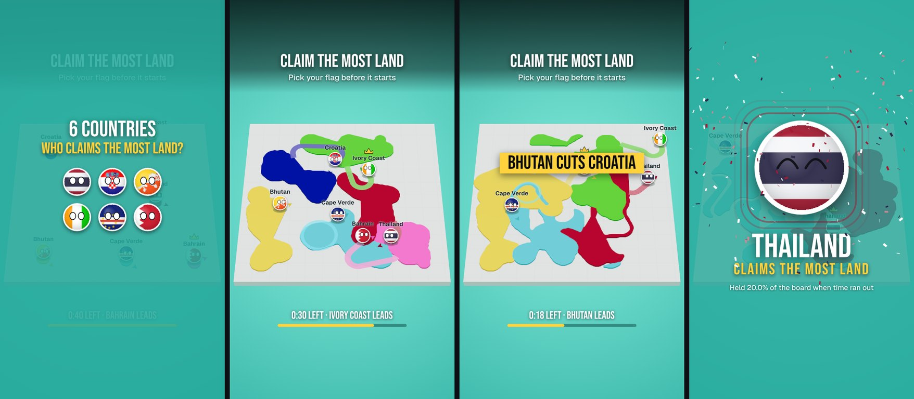

Like Paper.io 2. Every country is a **countryball** (its flag disc with cartoon eyes that look where it's heading,
blink, get scared when a rival is close and smile when it wins) rolling over a pale, tilted board floating on aqua water. Flags steer smoothly in curves, with an arrow showing where each one is heading and its name above. Outside
its land a flag leaves a ribbon trail; when it gets back home, the trail and everything it encloses become its land, in
one solid color per country, taken from whoever owned it. Crossing a rival's trail knocks that rival out: its land
fades away and it bursts into cubes. The flag with the most land wears a crown, banners call every cut, new leader
and "10 SECONDS LEFT", and when the clock runs out the most land wins (or the last flag left). Early on the flags
build; the hunting starts as the clock runs down. Shorts are one game of 4 to 7 flags; long videos are a knockout of
9 to 16 flags in 3 or 4 heats and a final. Claims ring a marimba that climbs with the size of the claim, cuts snip
like scissors, and the last five seconds tick. Open **Games, Paper Land, Watch a sample game** to try it.

### Black Hole

Like Hole.io. Every country is a hole in a city seen from above: a dark disc in a rim of its flag, with countryball
eyes that look where it's heading, get scared when a bigger hole is near and smile when it swallows a rival. The city
is a grid of blocks (parks, homes, shops, downtown towers) with cars, buses, lamps and cones on the roads. Anything
that fits in a hole and rolls mostly over it tips in, spinning and shrinking, and the hole grows by what it eats, so
holes work up from bushes and benches to cars, houses and finally towers. A clearly bigger hole swallows a smaller
one. The biggest hole wears a crown, banners call every swallow, new leader and "10 SECONDS LEFT", and when the clock
runs out the biggest hole wins (or the last one left). Long videos show the whole city; Shorts follow the leader with a
gentle camera. Shorts are one game of 4 to 7 holes; long videos are a knockout of 9 to 16 holes in 3 or 4 heats and a
final. Everything that falls in gulps (small things pop high, towers go down deep) and a hole eating a hole lands
with a deep whomp. Open **Games, Black Hole, Watch a sample game** to try it.

### Games

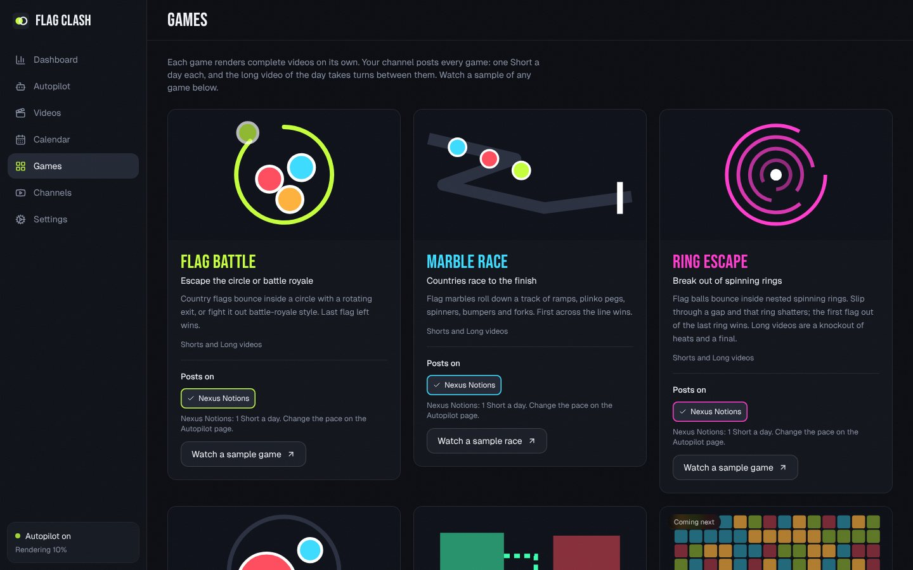

Every game has a **Watch a sample** page: play a fresh game with sound (Short or long video, a new one each time),
the same way the autopilot makes them, and export it as an MP4.

| Module | Status | The game |
| --- | :-: | --- |
| **Flag Battle** | ✅ Ready | Flags bounce inside a circle with a rotating exit; last one inside wins. Also has a battle royale mode with HP. |
| **Marble Race** | ✅ Ready | Flag marbles roll down ramps, plinko pegs, spinners, bumpers and forks; first across the line wins. |
| **Ring Escape** | ✅ Ready | Flag balls bounce inside spinning rings and shatter each one they get through; first out wins. Long videos are a knockout. |
| **Growing Ball** | ✅ Ready | Every bounce off the wall makes a flag bigger; when the arena is full, the biggest wins. Long videos are a knockout. |
| **Paper Land** | ✅ Ready | Like Paper.io: flags draw trails to claim land and cut rivals' trails; when the clock runs out, the most land wins. Long videos are a knockout. |
| **Black Hole** | ✅ Ready | Like Hole.io: country holes swallow a city, then each other; when the clock runs out, the biggest hole wins. Long videos are a knockout. |

Every game is live. A new game gets a written plan first (`src/modules/plans.ts`); while it is coming, its card on
**Games** has a **See the plan** button.

## 📅 How the autopilot posts

| Setting | Default | Range |
| --- | :-: | :-: |
| Planned ahead | **7 days** (up to 30 when preparing ahead) | rolling, every day |
| Shorts a day, per game | **1** | 0 to 10 |
| Long videos a day (the games take turns) | **1** | 0 to 3 |
| Games per channel | **every game** | any |
| Prepare ahead automatically | **Off** | every day or every week, at a set time |
| Hands-off mode | **Off** | 1 to 30 days ahead |
| Review before upload | **Off** | on or off |
| Posting hours | **9:00 to 23:00** | any |
| Post at peak hours | **On** | on or off |
| Where most viewers live | **Same as this computer** | 18 regions |
| Minimum gap between posts | **1 h** | 30 min to 4 h |
| Organic variation | **Off** | on or off |
| Daily upload limit (per channel) | **15** | 1 to 50 |
| Uploads a day, all channels | **100** (your Google project's upload quota) | 1 to 100 |
| Made for kids | **Off** | on or off |

- **One timeline per channel.** Every game posts its Shorts each day, and the long video of the day takes turns
  between the games, so each game's long video comes round regularly. A channel's games share the posting hours,
  the minimum gap and the daily upload limit, so its posts never overlap, and games alternate through the day. If the games together ask for more than the daily limit, posts
  are trimmed fairly from the busiest game.
- **A week ahead.** Every connected channel always has the next 7 days planned, and the plan rolls forward a day at
  a time. Each day's plan stays fixed unless you change the schedule, so what you see in the calendar is what will
  go out.
- **Peak-hour timing.** Posts follow when YouTube audiences are most active (lunch, after work, and the evening
  peak; later and longer on weekends) in your viewers' time zone. Each post gets an equal share of the day's
  viewers, at a random point inside it, so the times change every day and never land on round minutes. Long videos
  go to the slot where long-form viewing peaks. Set **Where most of your viewers live** to match YouTube Studio's
  *Audience, Top geographies*.
- **Organic variation** (off by default): some days post one more and others one fewer, balanced within each week.
- **Plenty of quota.** A Google project can upload 100 videos a day, so a whole month can be prepared in two nights.
  **Uploads a day, all channels** keeps the total under what you set, shared fairly between channels.
- **On time, every time.** Each post renders ahead (3 hours before it at the latest, or days ahead when you prepare
  ahead), uploads as private with a publish time, and YouTube publishes it on the planned minute, even if your PC
  is off by then.
- **Never repeats itself.** Flag Clash remembers what it posted. A country that already won doesn't win again until
  every other country in the lineup has had a turn, the same final two never meet twice, the number of flags
  differs from the last 15 posts, and lineups, regions, themes, modes and title styles avoid recent ones. (Country
  flags are physically identical, so this never bends the physics: it only decides which flag rides which ball.)
- **Spoiler-free thumbnails.** Each post uploads its own cover made from the start of the battle with a big
  question. Titles never name the winner either.
- **Resilient.** Uploads resume after network drops, failed posts retry after 5, 20 and 60 minutes, quota errors
  pause every upload until the daily reset (midnight Pacific), and posts missed while the PC was off are skipped
  instead of posted in a burst.

<table>
<tr>
<td width="68%">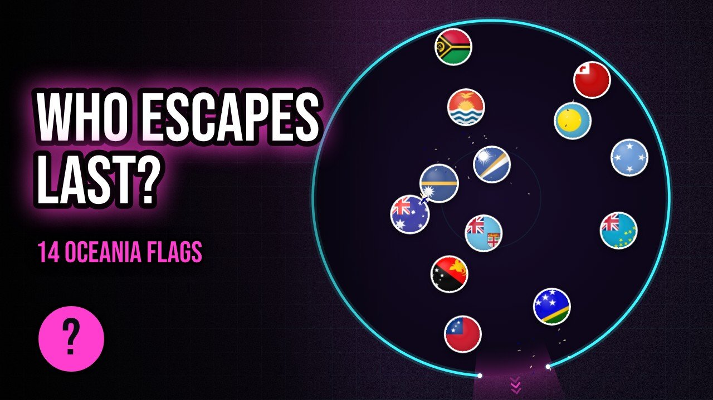</td>
<td width="32%">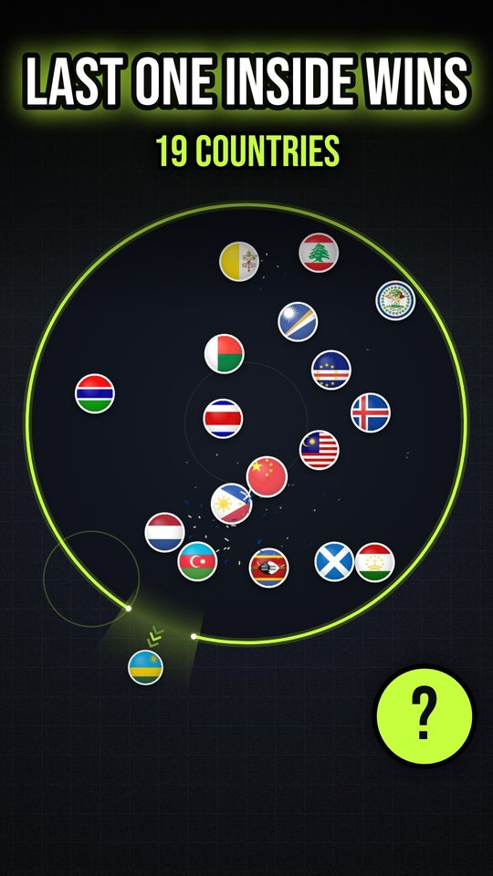</td>
</tr>
<tr>
<td align="center"><sub>Long video cover</sub></td>
<td align="center"><sub>Short cover</sub></td>
</tr>
</table>


> [!NOTE]
> The PC needs to be **on and awake** in the few hours before each post so it can render and upload it; after that,
> YouTube publishes it on time by itself. Rendering a Short takes about a minute on a typical laptop, and a long
> video a few minutes.

> [!NOTE]
> **Made for kids is off by default**, so comments, likes, notifications and the subscribe bell all work, and the
> videos ask viewers to comment their pick. Videos are still suitable for everyone. Turn it on on the Autopilot page
> if your audience is children; the videos then ask viewers to guess the winner instead of commenting.

> [!NOTE]
> **Community posts:** YouTube's API has no way to create Community posts (text, polls or images on the Posts tab),
> so Flag Clash can't post them for you. Every video's description already invites comments ("Comment your country").

<br />

## 🛠️ Troubleshooting

<details>
<summary><b>Windows says "Windows protected your PC"</b></summary>

The installer is not code-signed yet. Click **More info**, then **Run anyway**.
</details>

<details>
<summary><b>My videos are uploaded but private</b></summary>

Your Google Cloud project has not passed the YouTube API audit yet, so YouTube forces API uploads to private. Publish
them in YouTube Studio, and [request the audit](https://support.google.com/youtube/contact/yt_api_form) to post
publicly automatically.
</details>

<details>
<summary><b>"Access blocked" or "access_denied" when signing in</b></summary>

Open [Audience](https://console.cloud.google.com/auth/audience) and either click **Publish app**, or add your Google
account under **Test users**. Then try **Sign in with Google** again.
</details>

<details>
<summary><b>"redirect_uri_mismatch" or "invalid_client"</b></summary>

The client was created with the wrong type, or the keys were pasted incorrectly. Create a new client with
Application type **Desktop app** in [Clients](https://console.cloud.google.com/auth/clients), click **Download JSON**,
and load that file in **Settings** (or setup step 5). Flag Clash tells you if the file is for a "Web application"
client instead.
</details>

<details>
<summary><b>Google won't let me publish the app: it wants a home page and privacy policy</b></summary>

<br />

Google asks for an **Application home page** and a **Privacy policy link** on the
[Branding](https://console.cloud.google.com/auth/branding) page before you can publish, even for a desktop app. Use
two pages on a site you own. The free option is GitHub Pages: create a public repository named
`yourname.github.io` and add a short page about the app plus a privacy policy saying the app only uploads videos
you render and keeps your sign-in on your PC. Then add `yourname.github.io` under **Authorized domains**, save,
and click **Publish app** on the Audience page. After publishing, reconnect your channel once in **Platforms**.
</details>

<details>
<summary><b>"Custom thumbnail not set" in a post's timeline</b></summary>

<br />

YouTube only allows custom thumbnails on **verified** channels. Verify yours once at
[youtube.com/verify](https://www.youtube.com/verify) (a phone number is enough); later posts get their thumbnails
automatically. The video itself is posted either way. Note that the **Shorts feed** always plays the video itself;
a Short's custom thumbnail shows in search, on your channel page and in subscriptions.
</details>

<details>
<summary><b>Every week I have to sign in again</b></summary>

Your sign-in app is still in "Testing", where Google expires logins after 7 days. Open
[Audience](https://console.cloud.google.com/auth/audience), click **Publish app**, then reconnect the channel once in
**Platforms**.
</details>

<details>
<summary><b>A post failed. What happened?</b></summary>

<br />

Click it (on the Autopilot page or in the Calendar). Its timeline shows which step failed, the exact error from
YouTube, and when the next retry is. Failed posts retry after 5, 20 and 60 minutes before giving up; the rest of the
week carries on either way.
</details>

<details>
<summary><b>A render or upload seems stuck</b></summary>

<br />

On the **Videos** page, click **Try again** (the circular arrow) on that video: it stops the job and starts it over.
**Pause** holds a video without losing its place in the plan. Flag Clash also stops any render or upload that has made
no progress for 10 minutes and tries it again by itself. Long videos are written to disk as they render, so they no
longer wait at 99% while a large file is saved.
</details>

<details>
<summary><b>Facebook or Instagram says the token is invalid or a user token</b></summary>

<br />

Flag Clash needs the **Page access token**, not your own user token: in Graph API Explorer open **User or Page**,
pick your Page and copy that token. If posts later fail with an expired token, make a new long-lived one (steps 5
and 6 of the guide on the Platforms page) and connect again; your plan and settings are kept.
</details>

<details>
<summary><b>Posts fail with "quotaExceeded" or "uploadLimitExceeded"</b></summary>

The daily upload quota (100 uploads per Google project) or YouTube's own per-channel upload limit was reached.
Flag Clash pauses uploads and carries on after the daily reset (midnight Pacific time). Lower the daily upload limit
if it keeps happening.
</details>

<details>
<summary><b>Where are the videos saved? How do I uninstall?</b></summary>

Rendered videos go to `Videos\Flag Clash` (change it in **Settings**) and are deleted a few days after posting. To
uninstall, use **Windows Settings, Apps**. App data lives in `%APPDATA%\com.flagclash.desktop`, and the channel
login in Windows Credential Manager under `com.flagclash.desktop`.
</details>

<br />

## 👩‍💻 For developers

<details>
<summary><b>Build and run from source</b></summary>

<br />

Requires Node 20+, Rust (stable) and the [Tauri prerequisites](https://tauri.app/start/prerequisites/) for Windows
(WebView2 and the MSVC build tools). On a fresh PC, one script installs all of it with winget and then the npm
packages:

```powershell
git clone https://github.com/MisbahKhan0009/battle-world.git
cd battle-world
powershell -ExecutionPolicy Bypass -File scripts\setup-windows.ps1
```

Then:

```bash
npm run desktop:dev     # run the app with hot reload
npm run desktop:build   # build the Windows installer into src-tauri/target/release/bundle/nsis
```

| Script | What it does |
| --- | --- |
| `npm run dev` | The UI alone in a browser at http://localhost:5173 (autopilot screens show desktop-only notes) |
| `npm test` | Vitest: physics, determinism, duration tuning, peak-hour scheduler, autopilot engine, no-repeat content rules, client secret import |
| `npm run lint` | ESLint (includes a rule that bans `Math.random` and clock reads inside the simulation) |
| `npm run format` | Prettier |

**Releases.** The [Windows app workflow](.github/workflows/desktop.yml) lints, tests and builds on every push to
`main`, then publishes a release **Flag Clash 1.0.&lt;run number&gt;** (tag `build-<run number>`) with the installer.
Pushing a `v*` tag publishes a release under that tag instead.
</details>

<details>
<summary><b>Project structure</b></summary>

<br />

```
src-tauri/            Rust shell (Tauri 2)
  src/oauth.rs        Google sign-in: system browser, loopback redirect, PKCE, channel lookup
  src/tokens.rs       refresh tokens in Windows Credential Manager, access-token cache
  src/youtube.rs      resumable 8 MiB chunked uploads that resume after errors, custom thumbnails
  src/files.rs        state file (atomic writes), rendered videos streamed to disk in chunks (raw IPC body)
  src/meta.rs         Facebook Page and Instagram posting through Meta's Graph API (Reels, scheduled videos)
  src/tray.rs         tray menu and status
  src/lib.rs          window and tray lifecycle, launch at login, single instance, 30 s heartbeat
src/
  autopilot/          planner.ts (organic schedule), engagement.ts (audience activity curves),
                      engine.ts (render, upload, thumbnail, retry, history), types.ts (per-game paces)
  desktop/            bridge.ts (typed Tauri calls), runtime.ts (wires the engine to the UI)
  modules/            module registry, shared no-repeat rules and thumbnails (common.ts, thumbnail.ts),
                      flagBattle/, marbleRace/, ringEscape/, growingBall/, paperLand/, blackHole/ (content planning and autopilot rendering per game)
  dashboard/          channel data (youtube.ts), insights math (insights.ts), snapshots and cache (store.ts)
  app/desktop/        Setup guide, Dashboard, Autopilot, Videos, Calendar, Games, Platforms and Settings screens;
                      posts.tsx (the live post timeline)
  engine/             deterministic simulation: rng, physics, sim, timeline, tuning
  engine/race/        Marble Race: track generator, rolling-sphere physics, finish placement
  engine/rings/       Ring Escape: ring generator, bounce physics, ring-count fitting and knockout heats
  engine/grow/        Growing Ball: growing-ball physics, growth-rate fitting and knockout heats
  engine/paper/       Paper Land: grid rules, flood-fill claims, steering AI and knockout heats
  engine/black/       Black Hole: city generator, swallow rules, steering AI and knockout heats
  render/             the renderers shared by preview and export (render/race/, render/rings/, render/grow/,
                      render/paper/, render/black/),
                      show.ts (the shared frame for the round-based games), effects, themes
  audio/              procedural sound effects, streaming mixer, live preview audio
  export/             WebCodecs + mp4-muxer export worker and fallback; production.ts builds any game
scripts/setup-windows.ps1   one-time dev setup on Windows (Git, Node, Rust, MSVC, WebView2, npm packages)
CLAUDE.md             project notes for AI coding assistants
```
</details>

<details>
<summary><b>Adding a game module</b></summary>

<br />

Add an entry to `src/modules/registry.ts` with `status: 'ready'` and a `render(job, onProgress, signal)` function.
It receives `{ format: 'short' | 'video', seed, recent }`, where `recent` is the channel's content history, and
returns `{ bytes, ext, meta: { title, description, tags } }` plus, optionally, a JPEG `thumbnail` and a `content`
record (count, roster, winner…) that later posts use to avoid repeats. Add its default pace to `DEFAULT_PACE`
in `src/autopilot/types.ts`. The Platforms and Games pages, schedule cards, calendar and scheduler pick it up
automatically; the next channel you connect gets it (or add it to a channel on the Platforms page).
`src/modules/ringEscape/` and `src/modules/marbleRace/` are the most complete references; reuse `src/modules/common.ts` for fresh
lineups and winners, and `src/export/production.ts` to plug the game's renderer into the MP4 exporter.
</details>

<details>
<summary><b>Under the hood: physics, pacing and export</b></summary>

<br />

- **Deterministic.** Fixed 1/120 s physics steps, a seeded mulberry32 PRNG and only `+ - * / sqrt` (plus
  polynomial sin/cos accurate to 1e-8), so the same seed replays the same battle bit for bit. The renderer is a pure
  function of video time, so the export matches the preview frame for frame.
- **Escape physics.** The rim is a solid arc plus the opening's two edges as moving point obstacles. A flag is out
  once its center crosses the rim inside the opening; tests check every exit happens there.
- **Pacing director.** Chaotic battles make plain parameter searches unreliable, so a deterministic in-sim director
  (the "AI director" technique from games) compares progress with a planned curve and nudges speed first, then the
  opening width (damage in battle royale). Tests check 8 to 64 flags land within 3 s of 30, 45 and 58 s targets.
- **Marble Race physics.** Marbles are solid spheres (I = 2/5 m r²): every contact applies a normal impulse with
  restitution and a Coulomb friction impulse at the contact point, so marbles really roll (5/7 g sin θ down a ramp,
  spin equal to v / r), pick up spin and pass it on. Spinners are moving contacts whose surface speed counts,
  bumpers add a kick, and a marble that sits still for over a second gets a small hop, like the shakers on real
  marble runs. Tests check replays are bit for bit, no marble ever leaves the track, and every marble reaches the
  finish on 40 random tracks.
- **Race length without bending physics.** A probe race runs on a long track, and the finish line goes at the
  section boundary the leader reaches closest to the target time. Each section keeps a clear band at its top, so
  nothing above the line depends on what comes after it: the real race produces the same winner at the probed
  time (tested). A few candidate tracks are raced and the most exciting one (lead changes, close finish) is kept.
- **Ring Escape physics.** Each ring is a thin wall with round ends and one gap, turning at a constant rate. A ball
  that touches the wall bounces off it (restitution just above 1 and a speed cap keep the balls lively but
  watchable); inside the gap, the wall's two ends are moving points; a ball whose center crosses the ring inside the
  gap breaks it. Balls collide with each other. Ring k depends only on the seed and k, and only the ring the balls
  are in can be touched, so a probe game with many rings tells exactly when each ring would break: the game keeps
  the ring count whose last break lands closest to the target length (tested to match the real game bit for bit).
  Tests also check balls only ever leave a ring through its gap.
- **Growing Ball physics.** Balls bounce under gravity; ball-to-ball contacts are impulses with mass proportional to
  area, so big balls shove small ones. A firm wall bounce adds a fixed slice of area, and the wall is springy (it
  throws anything touching it back at a minimum speed), so balls never settle in a heap. Big balls get boxed in
  while small ones keep finding the wall, which keeps races close: on average the top two finish within a few
  percent and the lead changes several times. The game ends when the balls fill 55% of the arena; length is fitted
  by playing a range of growth rates in full and keeping the closest, liveliest game. Tests check balls stay inside
  the arena, never overlap, and the biggest wins.
- **Paper Land rules.** Flags move continuously at a fixed speed with a limited turn rate (smooth curves); land is
  kept on a fine grid (120 to 256 cells a side). Claiming flood-fills from the board's edges: whatever the flag's
  land and trail cut off from the edge becomes its land. Steering is a seeded AI with the same rules for every flag:
  plan a loop out of its land (bigger when behind), test each heading by flying the arc it can really turn (so flags
  don't run into walls or their own trail), head home along the shortest path when a rival gets close to its trail,
  and go for a rival's trail it can reach before the rival gets home (only in the second half). Land outlines are
  drawn with marching squares on a softened field, so they read as smooth blobs. The tilted board is rendered with
  three.js (also inside the export worker); the countryballs, titles and banners are 2D on top. The game runs on a clock of the target length; a few
  starts are played in full and the liveliest is kept (lead changes, a few cuts, a well-covered board, a close
  finish). Land is recorded only when it changes. Tests check the board always matches every flag's land, a cut
  flag's land is wiped, and the most land wins.
- **Black Hole rules.** The city is a seeded grid of blocks; every object has a size (its bounding radius) and a
  footprint. An object falls in once it fits (size at most 85% of the hole's radius) and its center is deep enough
  in the hole; the hole's area grows by part of the footprint. A hole 15% bigger swallows a smaller one when it covers
  its center. Every hole has the same speed (slightly slower as it grows) and the same seeded steering: head for the
  best food in reach (bigger and closer is better, ahead beats behind), flee bigger holes, and after the opening chase
  smaller ones; near a target it slows down so it turns onto it instead of circling it. The game runs on a clock; a
  few cities are played in full and the liveliest is kept. Tests check nothing larger than a hole ever falls in, only
  clearly bigger holes swallow, holes stay in the city, and the biggest wins.
- **Export.** Frame-by-frame rendering on an `OffscreenCanvas` in a worker, H.264 via WebCodecs (VP9/AV1 fallback),
  keyframe every 2 s, sound effects mixed in one-second chunks and encoded as AAC or Opus, muxed with `mp4-muxer`
  with the index at the front for fast YouTube processing.
- **Sound.** Every game sound is synthesized in `src/audio/synth.ts`: no audio files and no licensing risk. With
  music on, `src/desktop/music.ts` decodes a track from the user's folder and `src/audio/music.ts` (`MusicMix`)
  replaces the effects mixer with the looped, faded track.
</details>

<br />

## 🙏 Credits

- Flag artwork: [flag-icons](https://github.com/lipis/flag-icons) (MIT)
- Country data: [world-countries](https://github.com/mledoze/countries) (ODbL)
- Sound effects: synthesized in code, dedicated to the public domain (see [`public/audio/CREDITS.md`](public/audio/CREDITS.md))
- Built with [Tauri](https://tauri.app), [React](https://react.dev), [Vite](https://vite.dev) and
  [mp4-muxer](https://github.com/Vanilagy/mp4-muxer)

<div align="center">
<br />
<sub>Made for creators who would rather make the next game than press upload.</sub>
</div>
