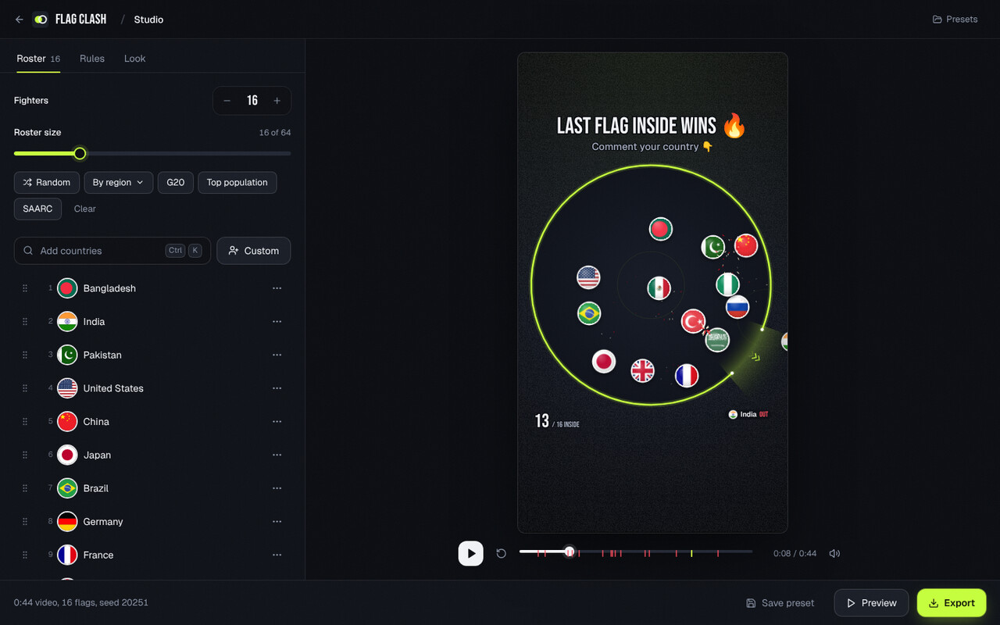

<div align="center">


# Flag Clash

**Viral flag-battle videos for YouTube, made and posted for you.**

Flag Clash renders physics game videos on your Windows PC and posts them to your YouTube channel on a natural,
human-looking schedule, while it sits quietly in the system tray.

[](https://github.com/MisbahKhan0009/battle-world/actions/workflows/desktop.yml)


[**Download**](#-download-and-install) &nbsp;&nbsp; [**Set up your channel**](#-set-up-your-channel-5-minutes) &nbsp;&nbsp; [**Daily use**](#%EF%B8%8F-using-flag-clash) &nbsp;&nbsp; [**How it posts**](#-how-the-autopilot-posts) &nbsp;&nbsp; [**Help**](#%EF%B8%8F-troubleshooting)

<br />


</div>

<br />

## ✨ What it does

| | |
| --- | --- |
| 🎬 **Makes the videos** | Two games so far. **Flag Battle**: up to 64 country flags bounce inside a circle with one rotating exit; the last flag inside wins. **Marble Race**: flag marbles roll down a track of ramps, plinko pegs, spinners and bumpers; first across the line wins. No two posts repeat a winner, a lineup or even a flag count. |
| 🖼️ **Spoiler-free thumbnails** | Every post gets its own cover ("WHO ESCAPES LAST?") made from the start of the battle, so the thumbnail never gives the winner away. |
| 📅 **Posts on autopilot** | Each game has its own schedule (about 5 Shorts a day and 4 long videos a week together by default), all on one timeline so posts never overlap, planned a full week ahead and timed for when your audience is most active. Everything is adjustable. |
| 📊 **Channel dashboard** | Subscribers and views over time, every upload against your typical result, which game performs best, your best hours to post, and your top videos, in one page. |
| 🗓️ **Calendar and live tracking** | One calendar for every game, color-coded with a filter per game. Click any post to watch it render, upload and go live, step by step. |
| 🔊 **Sound that fits** | Bumps, exits, eliminations and a winner fanfare, timed to the action. No background music, so no copyright claims. |
| 🖥️ **Runs in the background** | Lives in the system tray, starts with Windows, renders each post a few hours ahead and lets YouTube publish it on the minute. |
| 🔒 **Your account stays yours** | Uses your own free Google Cloud project. Your sign-in is stored in Windows Credential Manager, never in plain files. |
| 🧩 **More games coming** | Flag Battle and Marble Race are live. Ring Escape, Territory Wars, Growing Ball, Black Hole (like Hole.io) and Paper Land (like Paper.io) are next, each with a written plan in the app. |

<br />

## 📑 Contents

- [Download and install](#-download-and-install)
- [Set up your channel (5 minutes)](#-set-up-your-channel-5-minutes)
- [Using Flag Clash](#%EF%B8%8F-using-flag-clash)
- [How the autopilot posts](#-how-the-autopilot-posts)
- [Troubleshooting](#%EF%B8%8F-troubleshooting)
- [For developers](#-for-developers)
- [Credits](#-credits)

<br />

## 📥 Download and install

1. Open the [**Releases**](https://github.com/MisbahKhan0009/battle-world/releases) page. Every update to the app
   publishes a new release named **Flag Clash 1.0.N** (the newest is at the top, marked *Latest*).
2. Under **Assets**, download **`Flag.Clash_1.0.N_x64-setup.exe`**.
3. Run it. Windows SmartScreen may show **"Windows protected your PC"** because the app is not code-signed yet:
   click **More info**, then **Run anyway**.
4. Flag Clash opens on its setup guide. Continue below.

> [!TIP]
> **Updating** is the same: download the newest installer and run it. It updates in place and keeps your channels,
> schedule, history and keys. If you ever reinstall from scratch, setup step 5 takes the same `client_secret_….json`
> file again, so there is nothing to retype.

<br />

## 🔑 Set up your channel (5 minutes)

Flag Clash posts through YouTube's official API using a **free Google Cloud project that belongs to you**. The app
includes an interactive guide that walks you through every click, with one-click links, values to copy, and a picture
of each Google page with the right buttons highlighted.


You will need **a Google account that owns a YouTube channel**. No credit card is needed.

<details open>
<summary><b>The steps, in case you want to read them first</b></summary>

<br />

| # | Step | Where | What to do |
| :-: | --- | --- | --- |
| 1 | **Create a project** | [New project](https://console.cloud.google.com/projectcreate) | Name it `Flag Clash` and click **Create**. Make sure it is selected in the project picker at the top. |
| 2 | **Turn on the YouTube API** | [YouTube Data API v3](https://console.cloud.google.com/apis/library/youtube.googleapis.com) | Click **Enable**. |
| 3 | **Set up Google sign-in** | [Google Auth Platform](https://console.cloud.google.com/auth/overview) | Click **Get started**. App name `Flag Clash`, your email as support email, Audience **External**, your email as contact, accept and **Create**. |
| 4 | **Keep the sign-in alive** | [Branding](https://console.cloud.google.com/auth/branding), then [Audience](https://console.cloud.google.com/auth/audience) | On Branding, add an **Application home page** and **Privacy policy link** (two pages on a site you own, for example a free `yourname.github.io` GitHub Pages site) and add that domain under **Authorized domains**. Then on Audience click **Publish app**, **Confirm**. (Apps left in "Testing" are signed out by Google every 7 days.) |
| 5 | **Create the app's keys** | [Clients](https://console.cloud.google.com/auth/clients) | **Create client**, Application type **Desktop app**, name `Flag Clash`, **Create**. Click **Download JSON**, then in Flag Clash click **Choose the downloaded JSON file**. (Pasting the Client ID and secret also works.) |
| 6 | **Connect your channel** | In Flag Clash | Click **Sign in with Google**, pick your channel's account. On "Google hasn't verified this app" click **Advanced**, then **Go to Flag Clash (unsafe)**, and allow both permissions. |
| 7 | **Pick a pace** | In Flag Clash | Maximum (default), Steady or Light, where most of your viewers live, and who can see the videos. Click **Start autopilot**. The week's plan appears right away. |

</details>

<table>
<tr>
<td width="50%"></td>
<td width="50%"></td>
</tr>
<tr>
<td align="center"><sub>Step 5: pick the downloaded JSON, or paste the keys</sub></td>
<td align="center"><sub>Step 6: what to click on Google's warning page</sub></td>
</tr>
</table>

> [!IMPORTANT]
> **Public videos need a one-time audit.** YouTube keeps videos uploaded from a new Google Cloud project **private**
> until the project passes the free [YouTube API audit](https://support.google.com/youtube/contact/yt_api_form).
> Until then, choose **Private for now** in step 7: posts land in YouTube Studio as private videos you can publish
> yourself. After approval, switch visibility to **Public** on the Autopilot page.

> [!NOTE]
> **Is "Go to Flag Clash (unsafe)" safe?** Yes. The warning appears because the sign-in app is *yours* and has not
> been reviewed by Google, not because something is wrong. Flag Clash only asks to upload videos and read your
> channel's name, and the login never leaves your computer.

<br />

## 🎛️ Using Flag Clash

### Dashboard


Your channel at a glance, with the things YouTube Studio does not show you:

- **Totals and growth:** subscribers, views and videos with their change over 7 days, and growth charts. Flag
  Clash saves your totals every 3 hours while it runs, so the charts fill in over the first days.
- **Latest uploads:** views of your last 30 uploads, colored by game, against your typical Short (dashed line).
- **Which game performs best:** average views and engagement per game and format, for everything the autopilot
  posted.
- **Best hours to post:** median Short views by the hour they went live, with your top three hours called out.
- **Top videos:** views, views per day, likes, comments and how many times your typical result each one got.

It uses the same read-only YouTube access the app already has (a few API units per refresh), so there is nothing
extra to set up. **Refresh** reloads it; **YouTube Studio** opens your channel there.

### Autopilot


- **The top card** shows what is happening right now (rendering or uploading, with progress) or when the next post
  goes out.
- **This week** lists every post planned for the next 7 days, grouped by day, including ones already uploaded and
  waiting for YouTube to publish them. **Skip** any you don't want.
- **Click any post** to open its timeline: planned, rendering (with a live progress bar), uploading, scheduled on
  YouTube (with a countdown) and live, plus every event, error and retry along the way.
- **Post now** renders and uploads one Short or long video immediately, outside the schedule. Great for a first test.
- **Pause autopilot** stops new posts (also available from the tray icon).
- **Recent posts** links each upload to YouTube and shows the reason if one failed.
- **Schedule** (right column) has a card per game with **−** and **+** buttons for its **Shorts a day** and **long
  videos a week**, a switch to turn the game on or off, and how many of each are actually planned for the next 7
  days. Changes stay a draft until you click **Replan the week** (or **Reset** to undo): then the week, the calendar
  and the counts update, and posts already rendering or uploaded are kept. If your games together ask for more than
  the **daily upload limit**, a warning explains that each day keeps the limit, trimmed fairly from the busiest game.

### Calendar


The **Calendar** shows every post of every game by day: **live** ones in green, **scheduled** on YouTube in blue,
**planned** ones (dashed) for the days ahead, plus anything that failed or was skipped. Each post carries its game's
color (a dot for a Short, a square for a long video), and the **All games / Flag Battle / Marble Race** filter shows
one game at a time. Click a day to list its posts, and click a post to follow it live.

### Settings

- **Google API credentials:** load them from the `client_secret_….json` file or paste them.
- **Rendered videos:** the folder videos are saved to (default `Videos\Flag Clash`), and how many days to keep them
  after posting (default 3; 0 deletes them right after upload).
- **Background:** launch when you sign in to Windows, and keep running in the tray when the window closes (both on
  by default).
- **About:** the installed version. Newer versions are on the [Releases](https://github.com/MisbahKhan0009/battle-world/releases) page.

### Tray and startup

Closing the window keeps Flag Clash running in the **system tray** (bottom right of the taskbar; click **^** if it
is hidden). Right-click the icon to open the app, start or pause the autopilot, or **Quit**. Flag Clash starts with
Windows by default so the schedule survives restarts; turn that off in **Settings**.

### Marble Race


Flag marbles race down a freshly generated track: zigzag **ramps**, **plinko** peg fields, rotating **spinners**,
**bumpers** that kick, funnels, and **forks** where the field splits into two lanes. The camera follows the front of
the race, the standings update live, a **FINAL STRETCH** banner marks the last section, close finishes get a
**PHOTO FINISH** slow motion, and the video ends on the winner alone. Sounds are glassy clicks between marbles and dry wooden clicks on the track (no drum thuds). Open **Modules, Marble Race, Watch a sample
race** to play random races with sound and export one by hand.

### Studio and modules

<table>
<tr>
<td width="50%"></td>
<td width="50%"></td>
</tr>
<tr>
<td align="center"><sub>Studio: build and export a battle by hand</sub></td>
<td align="center"><sub>Modules: choose which games the autopilot uses</sub></td>
</tr>
</table>

Open **Modules, Flag Battle, Open studio** to make a video yourself: pick countries (or upload your own images), set
the rules and look, preview it, and **Export** an MP4. Handy shortcuts: <kbd>Space</kbd> play or pause,
<kbd>R</kbd> restart, <kbd>E</kbd> export, <kbd>Ctrl</kbd>+<kbd>K</kbd> add countries.

| Module | Status | The game |
| --- | :-: | --- |
| **Flag Battle** | ✅ Ready | Flags bounce inside a circle with a rotating exit; last one inside wins. Also has a battle royale mode with HP. |
| **Marble Race** | ✅ Ready | Flag marbles roll down ramps, plinko pegs, spinners, bumpers and forks; first across the line wins. |
| Ring Escape | 🔜 Next | A flag breaks out through nested rotating rings, shattering each one. |
| Territory Wars | 🔜 Next | Countries conquer a pixel world map tile by tile. |
| Growing Ball | 🔜 Next | Every bounce makes the flag bigger until it fills the arena. |
| Black Hole | 🔜 Next | Like Hole.io: country holes swallow a city, then each other. The biggest hole wins. |
| Paper Land | 🔜 Next | Like Paper.io: flags paint trails to claim land; crossing a trail knocks a flag out. |

Every upcoming game has a plan (how it plays, the simulation, the video formats and the build steps): open
**Modules** and click **See the plan** on its card. The short version:

<details>
<summary><b>Game plans</b></summary>

<br />

| Game | How it plays | Simulation | Videos |
| --- | --- | --- | --- |
| **Ring Escape** | A flag bounces out through 8 to 12 rotating rings, shattering each one; or four flags race to escape first. | Flag Battle's escape physics (solid arc + moving gap edges); length fitted by ring count and gap widths from probe runs. | Shorts 30 to 58 s; long videos as a tournament of escapes. |
| **Territory Wars** | Countries start on their real land on a pixel world map and push borders until one rules the globe. | Deterministic cellular automaton with seeded border contests; identical armies per tile. | Long time-lapse videos of 3 to 4 min; Shorts show the final 50 s. |
| **Growing Ball** | Every wall bounce grows the flag; first to fill half the arena wins, with notes that deepen as balls grow. | Circle collisions with growth after each wall hit and overlap resolution; growth rate fitted from probes. | Shorts 30 to 55 s; long videos as one-on-one brackets. |
| **Black Hole** | Country holes roam a city swallowing anything smaller; bigger holes eat smaller ones; biggest wins. | Seeded steering AI per hole; objects tip in when mostly over a big enough hole; identical rules for every hole. | Shorts 40 to 58 s on the leader; long videos of 2 to 3 min. |
| **Paper Land** | Flags leave trails outside their land and close loops to claim area; crossing a trail eliminates a flag. | Grid ticks with flood-fill claiming and trail-cut checks; seeded AI with identical rules. | Shorts 40 to 58 s; long videos of 3 min on a bigger board. |

All of them follow the same rules as the live games: same seed, same video; no repeated winners; spoiler-free
thumbnails; their own schedule on the shared timeline.

</details>

<br />

## 📅 How the autopilot posts

| Setting | Default | Range |
| --- | :-: | :-: |
| Planned ahead | **7 days** | rolling, every day |
| Flag Battle: Shorts per day, long videos per week | **3** and **2** | 0 to 10, 0 to 14 |
| Marble Race: Shorts per day, long videos per week | **2** and **2** | 0 to 10, 0 to 14 |
| Posting hours | **9:00 to 23:00** | any |
| Post at peak hours | **On** | on or off |
| Where most viewers live | **Same as this computer** | 18 regions |
| Minimum gap between posts | **1 h 15 min** | 30 min to 4 h |
| Organic variation | **On** | on or off |
| Daily upload limit | **6** | 1 to 20 |
| Made for kids | **On** | on or off |

- **One timeline for every game.** Each game keeps its own pace, and all of them share the posting hours, the
  minimum gap and the daily upload limit, so posts never overlap. Games alternate through the day, and each game's
  long videos land on different days of the week. If the games together ask for more than the daily limit, posts
  are trimmed fairly from the busiest game.
- **A week ahead.** Every connected channel always has the next 7 days planned, and the plan rolls forward a day at
  a time. Each day's plan stays fixed unless you change the schedule, so what you see in the calendar is what will
  go out.
- **Peak-hour timing.** Posts follow when YouTube audiences are most active (lunch, after work, and the evening
  peak; later and longer on weekends) in your viewers' time zone. Each post gets an equal share of the day's
  viewers, at a random point inside it, so the times change every day and never land on round minutes. Long videos
  go to the slot where long-form viewing peaks. Set **Where most of your viewers live** to match YouTube Studio's
  *Audience, Top geographies*.
- **Organic variation.** Some days post one more and others one fewer, balanced within each week, so every game's
  weekly total always matches its pace.
- **Right at the limit, not over it.** YouTube's default API quota is 10,000 units a day and each upload costs about
  1,600, so about **6 uploads a day** fit. The defaults use that fully. To post more, request a quota increase from
  Google and raise the daily limit.
- **On time, every time.** Each post renders up to 3 hours ahead, uploads as private with a publish time, and
  YouTube publishes it on the planned minute, even if your PC is asleep by then.
- **Never repeats itself.** Flag Clash remembers what it posted. A country that already won doesn't win again until
  every other country in the lineup has had a turn, the same final two never meet twice, the number of flags
  differs from the last 15 posts, and lineups, regions, themes, modes and title styles avoid recent ones. (Country
  flags are physically identical, so this never bends the physics: it only decides which flag rides which ball.)
- **Spoiler-free thumbnails.** Each post uploads its own cover made from the start of the battle with a big
  question. Titles never name the winner either.
- **Resilient.** Uploads resume after network drops, failed posts retry after 5, 20 and 60 minutes, quota errors
  wait for the daily reset, and posts missed while the PC was off are skipped instead of posted in a burst.

<table>
<tr>
<td width="68%"></td>
<td width="32%"></td>
</tr>
<tr>
<td align="center"><sub>Long video cover</sub></td>
<td align="center"><sub>Short cover</sub></td>
</tr>
</table>


> [!NOTE]
> The PC needs to be **on and awake** in the few hours before each post so it can render and upload it; after that,
> YouTube publishes it on time by itself. Rendering a Short takes about a minute on a typical laptop, and a long
> video a few minutes.

> [!NOTE]
> **Made for kids is on by default**, so the videos are marked as suitable for everyone. YouTube then turns off
> comments, notifications and personalised ads on those videos, so the videos ask viewers to guess the winner instead
> of commenting. Switch it off on the Autopilot page (or in the last setup step) if you want comments.

> [!NOTE]
> **Community posts:** YouTube's API has no way to create Community posts (text, polls or images on the Posts tab),
> so Flag Clash can't post them for you. Every video's description already invites comments ("Comment your country").

<br />

## 🛠️ Troubleshooting

<details>
<summary><b>Windows says "Windows protected your PC"</b></summary>

The installer is not code-signed yet. Click **More info**, then **Run anyway**.
</details>

<details>
<summary><b>My videos are uploaded but private</b></summary>

Your Google Cloud project has not passed the YouTube API audit yet, so YouTube forces API uploads to private. Publish
them in YouTube Studio, and [request the audit](https://support.google.com/youtube/contact/yt_api_form) to post
publicly automatically.
</details>

<details>
<summary><b>"Access blocked" or "access_denied" when signing in</b></summary>

Open [Audience](https://console.cloud.google.com/auth/audience) and either click **Publish app**, or add your Google
account under **Test users**. Then try **Sign in with Google** again.
</details>

<details>
<summary><b>"redirect_uri_mismatch" or "invalid_client"</b></summary>

The client was created with the wrong type, or the keys were pasted incorrectly. Create a new client with
Application type **Desktop app** in [Clients](https://console.cloud.google.com/auth/clients), click **Download JSON**,
and load that file in **Settings** (or setup step 5). Flag Clash tells you if the file is for a "Web application"
client instead.
</details>

<details>
<summary><b>Google won't let me publish the app: it wants a home page and privacy policy</b></summary>

<br />

Google asks for an **Application home page** and a **Privacy policy link** on the
[Branding](https://console.cloud.google.com/auth/branding) page before you can publish, even for a desktop app. Use
two pages on a site you own. The free option is GitHub Pages: create a public repository named
`yourname.github.io` and add a short page about the app plus a privacy policy saying the app only uploads videos
you render and keeps your sign-in on your PC. Then add `yourname.github.io` under **Authorized domains**, save,
and click **Publish app** on the Audience page. After publishing, reconnect your channel once in **Channels**.
</details>

<details>
<summary><b>"Custom thumbnail not set" in a post's timeline</b></summary>

<br />

YouTube only allows custom thumbnails on **verified** channels. Verify yours once at
[youtube.com/verify](https://www.youtube.com/verify) (a phone number is enough); later posts get their thumbnails
automatically. The video itself is posted either way. Note that the **Shorts feed** always plays the video itself;
a Short's custom thumbnail shows in search, on your channel page and in subscriptions.
</details>

<details>
<summary><b>Every week I have to sign in again</b></summary>

Your sign-in app is still in "Testing", where Google expires logins after 7 days. Open
[Audience](https://console.cloud.google.com/auth/audience), click **Publish app**, then reconnect the channel once in
**Channels**.
</details>

<details>
<summary><b>A post failed. What happened?</b></summary>

<br />

Click it (on the Autopilot page or in the Calendar). Its timeline shows which step failed, the exact error from
YouTube, and when the next retry is. Failed posts retry after 5, 20 and 60 minutes before giving up; the rest of the
week carries on either way.
</details>

<details>
<summary><b>Posts fail with "quotaExceeded" or "uploadLimitExceeded"</b></summary>

The daily API quota or YouTube's own upload limit was reached. Flag Clash waits and retries after the daily reset.
Lower the daily upload limit, or request more quota in Google Cloud.
</details>

<details>
<summary><b>Where are the videos saved? How do I uninstall?</b></summary>

Rendered videos go to `Videos\Flag Clash` (change it in **Settings**) and are deleted a few days after posting. To
uninstall, use **Windows Settings, Apps**. App data lives in `%APPDATA%\com.flagclash.desktop`, and the channel
login in Windows Credential Manager under `com.flagclash.desktop`.
</details>

<br />

## 👩‍💻 For developers

<details>
<summary><b>Build and run from source</b></summary>

<br />

Requires Node 20+, Rust (stable) and the [Tauri prerequisites](https://tauri.app/start/prerequisites/) for Windows
(WebView2 and the MSVC build tools). On a fresh PC, one script installs all of it with winget and then the npm
packages:

```powershell
git clone https://github.com/MisbahKhan0009/battle-world.git
cd battle-world
powershell -ExecutionPolicy Bypass -File scripts\setup-windows.ps1
```

Then:

```bash
npm run desktop:dev     # run the app with hot reload
npm run desktop:build   # build the Windows installer into src-tauri/target/release/bundle/nsis
```

| Script | What it does |
| --- | --- |
| `npm run dev` | The UI alone in a browser at http://localhost:5173 (autopilot screens show desktop-only notes) |
| `npm test` | Vitest: physics, determinism, duration tuning, peak-hour scheduler, autopilot engine, no-repeat content rules, client secret import |
| `npm run lint` | ESLint (includes a rule that bans `Math.random` and clock reads inside the simulation) |
| `npm run format` | Prettier |

**Releases.** The [Windows app workflow](.github/workflows/desktop.yml) lints, tests and builds on every push to
`main`, then publishes a release **Flag Clash 1.0.&lt;run number&gt;** (tag `build-<run number>`) with the installer.
Pushing a `v*` tag publishes a release under that tag instead.
</details>

<details>
<summary><b>Project structure</b></summary>

<br />

```
src-tauri/            Rust shell (Tauri 2)
  src/oauth.rs        Google sign-in: system browser, loopback redirect, PKCE, channel lookup
  src/tokens.rs       refresh tokens in Windows Credential Manager, access-token cache
  src/youtube.rs      resumable 8 MiB chunked uploads that resume after errors, custom thumbnails
  src/files.rs        state file (atomic writes), saving rendered videos (raw IPC body)
  src/tray.rs         tray menu and status
  src/lib.rs          window and tray lifecycle, launch at login, single instance, 30 s heartbeat
src/
  autopilot/          planner.ts (organic schedule), engagement.ts (audience activity curves),
                      engine.ts (render, upload, thumbnail, retry, history), types.ts (per-game paces)
  desktop/            bridge.ts (typed Tauri calls), runtime.ts (wires the engine to the UI)
  modules/            module registry, shared no-repeat rules and thumbnails (common.ts, thumbnail.ts),
                      flagBattle/ and marbleRace/ (content planning and autopilot rendering per game)
  dashboard/          channel data (youtube.ts), insights math (insights.ts), snapshots and cache (store.ts)
  app/desktop/        Setup guide, Dashboard, Autopilot, Calendar, Modules, Channels and Settings screens;
                      posts.tsx (the live post timeline)
  app/                Studio and Preview screens
  engine/             deterministic simulation: rng, physics, sim, timeline, tuning
  engine/race/        Marble Race: track generator, rolling-sphere physics, finish placement
  render/             the renderers shared by preview and export (render/race/ for the race), effects, themes
  audio/              procedural sound effects, streaming mixer, live preview audio
  export/             WebCodecs + mp4-muxer export worker and fallback; production.ts builds any game
scripts/setup-windows.ps1   one-time dev setup on Windows (Git, Node, Rust, MSVC, WebView2, npm packages)
CLAUDE.md             project notes for AI coding assistants
```
</details>

<details>
<summary><b>Adding a game module</b></summary>

<br />

Add an entry to `src/modules/registry.ts` with `status: 'ready'` and a `render(job, onProgress, signal)` function.
It receives `{ format: 'short' | 'video', seed, recent }`, where `recent` is the channel's content history, and
returns `{ bytes, ext, meta: { title, description, tags } }` plus, optionally, a JPEG `thumbnail` and a `content`
record (count, roster, winner…) that later posts use to avoid repeats. Add its default pace to `DEFAULT_PACE`
in `src/autopilot/types.ts`. The autopilot, calendar, schedule cards, Modules page and scheduler pick it up
automatically. `src/modules/marbleRace/` is the most complete reference; reuse `src/modules/common.ts` for fresh
lineups and winners, and `src/export/production.ts` to plug the game's renderer into the MP4 exporter.
</details>

<details>
<summary><b>Under the hood: physics, pacing and export</b></summary>

<br />

- **Deterministic.** Fixed 1/120 s physics steps, a seeded mulberry32 PRNG and only `+ - * / sqrt` (plus
  polynomial sin/cos accurate to 1e-8), so the same seed replays the same battle bit for bit. The renderer is a pure
  function of video time, so the export matches the preview frame for frame.
- **Escape physics.** The rim is a solid arc plus the opening's two edges as moving point obstacles. A flag is out
  once its center crosses the rim inside the opening; tests check every exit happens there.
- **Pacing director.** Chaotic battles make plain parameter searches unreliable, so a deterministic in-sim director
  (the "AI director" technique from games) compares progress with a planned curve and nudges speed first, then the
  opening width (damage in battle royale). Tests check 8 to 64 flags land within 3 s of 30, 45 and 58 s targets.
- **Marble Race physics.** Marbles are solid spheres (I = 2/5 m r²): every contact applies a normal impulse with
  restitution and a Coulomb friction impulse at the contact point, so marbles really roll (5/7 g sin θ down a ramp,
  spin equal to v / r), pick up spin and pass it on. Spinners are moving contacts whose surface speed counts,
  bumpers add a kick, and a marble that sits still for over a second gets a small hop, like the shakers on real
  marble runs. Tests check replays are bit for bit, no marble ever leaves the track, and every marble reaches the
  finish on 40 random tracks.
- **Race length without bending physics.** A probe race runs on a long track, and the finish line goes at the
  section boundary the leader reaches closest to the target time. Each section keeps a clear band at its top, so
  nothing above the line depends on what comes after it: the real race produces the same winner at the probed
  time (tested). A few candidate tracks are raced and the most exciting one (lead changes, close finish) is kept.
- **Export.** Frame-by-frame rendering on an `OffscreenCanvas` in a worker, H.264 via WebCodecs (VP9/AV1 fallback),
  keyframe every 2 s, sound effects mixed in one-second chunks and encoded as AAC or Opus, muxed with `mp4-muxer`
  with the index at the front for fast YouTube processing.
- **Sound.** Every sound is synthesized in `src/audio/synth.ts`: no audio files and no licensing risk.
</details>

<br />

## 🙏 Credits

- Flag artwork: [flag-icons](https://github.com/lipis/flag-icons) (MIT)
- Country data: [world-countries](https://github.com/mledoze/countries) (ODbL)
- Sound effects: synthesized in code, dedicated to the public domain (see [`public/audio/CREDITS.md`](public/audio/CREDITS.md))
- Built with [Tauri](https://tauri.app), [React](https://react.dev), [Vite](https://vite.dev) and
  [mp4-muxer](https://github.com/Vanilagy/mp4-muxer)

<div align="center">
<br />
<sub>Made for creators who would rather make the next game than press upload.</sub>
</div>
